# Devicely in action

Real iPhones, iPads and Android devices, recorded from the hosted Command Center at [devicely-ai.vercel.app](https://devicely-ai.vercel.app). Every clip is a real recording; only captions and privacy blurring were added.

**Try it:** `npm install -g devicely && devicely start` (or `npx devicely@latest start`). [Quick start](../README.md#quick-start)

Jump to: [Commander](#1-tap-once-every-iphone-ipad-and-android-follows) · [Plain English](#4-say-what-you-want-it-runs-everywhere) · [Apps](#5-launch-or-kill-any-app-on-every-device) · [Locators](#7-hover-any-locator-see-it-on-the-device) · [Flows](#9-record-once-replay-on-every-device) · [Virtual devices](#10-real-phones-emulators-and-simulators-one-fleet) · [AI agents (MCP)](#11-claude-code-drives-real-iphones-ipads-and-androids)

---

## 1. Tap once. Every iPhone, iPad and Android follows.

Commander mode: pick one device to lead, and every tap, swipe and keystroke is mirrored on the rest of the fleet. Real devices, no code.

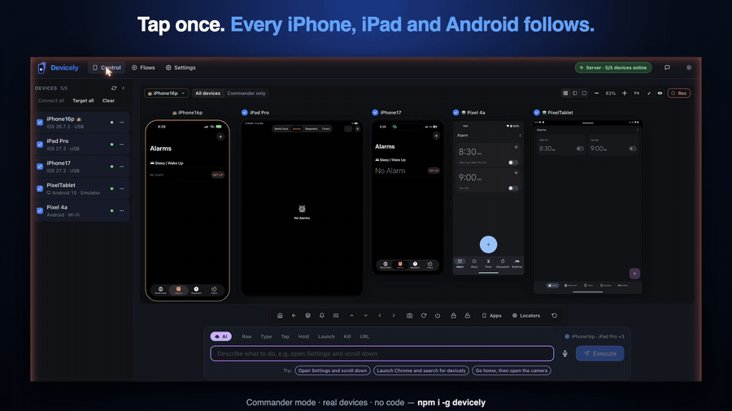

## 2. Dark mode on every iPhone, iPad and Android

One command per platform, and five screens switch from light to dark.

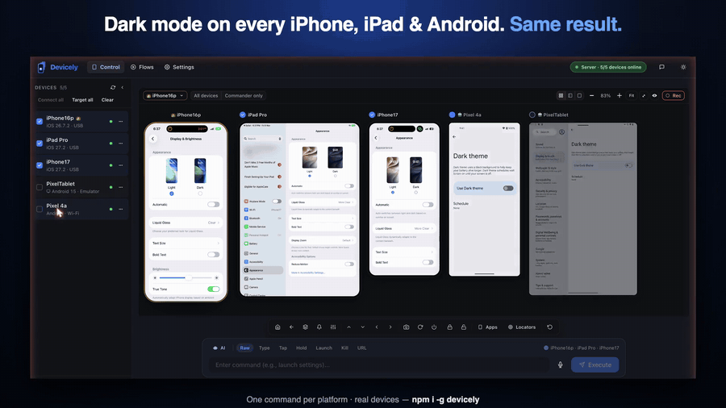

## 3. Open a URL on every phone and tablet. At once.

Safari and Chrome, iOS and Android, phone and tablet sizes side by side: one step for responsive and cross-browser checks.

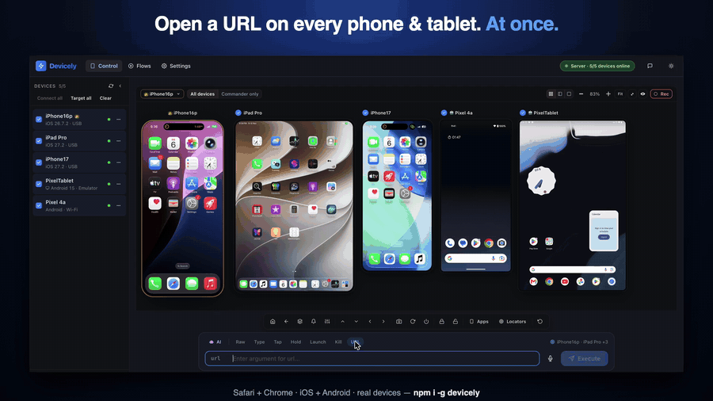

## 4. Say what you want. It runs everywhere.

Plain-English commands, such as "Open Clock, go to Stopwatch and start it", run on iOS and Android together.

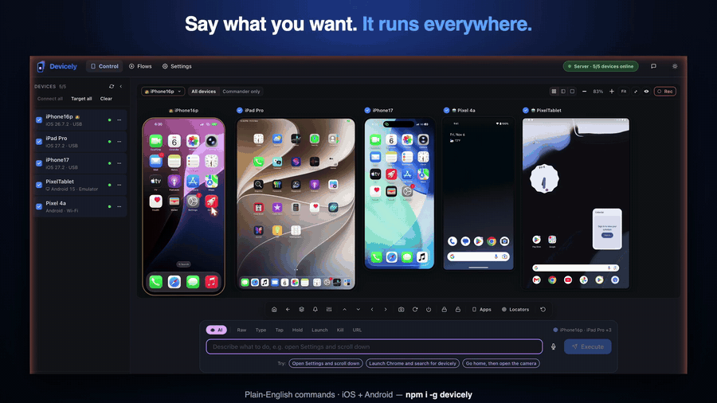

## 5. Launch or kill any app. On every device.

The Apps panel searches installed apps and launches or closes them everywhere. It also installs `.ipa` and `.apk` files.

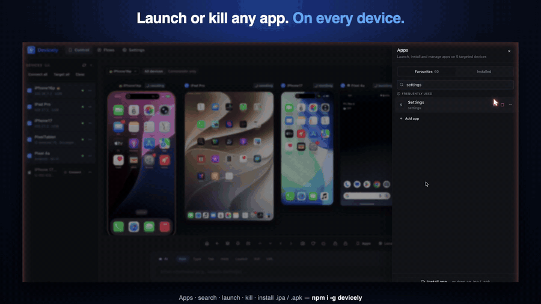

## 6. Choose who leads and who follows. Live.

Press ⌘K to make another device the commander or leave one out, without stopping the session.

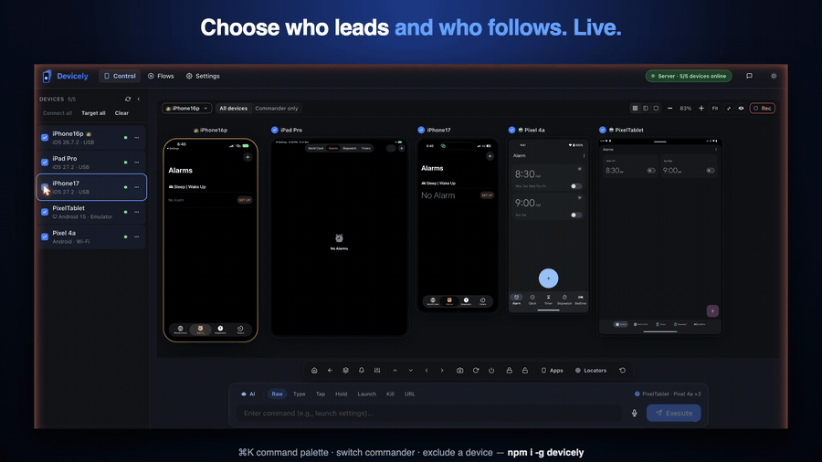

## 7. Hover any locator. See it on the device.

The Locators panel reads the commander's screen. Hover a row to highlight that element on the device.

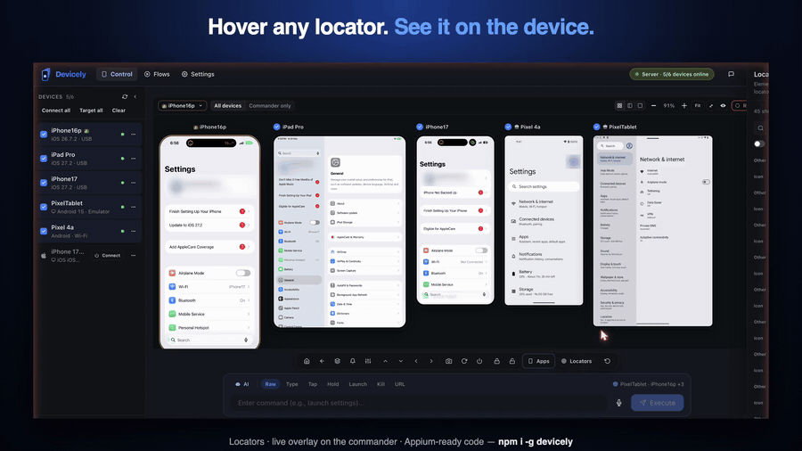

## 8. Point at any element. Get test code.

Ready-to-paste locators for Appium (Java and Python) and WebdriverIO.

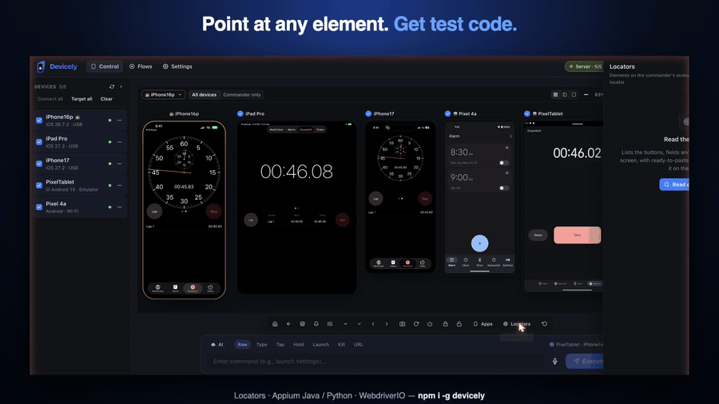

## 9. Record once. Replay on every device.

Save what you did as a Flow and replay it on any devices, iOS and Android, with no code. Flows also export as Maestro, Appium or WebdriverIO tests.

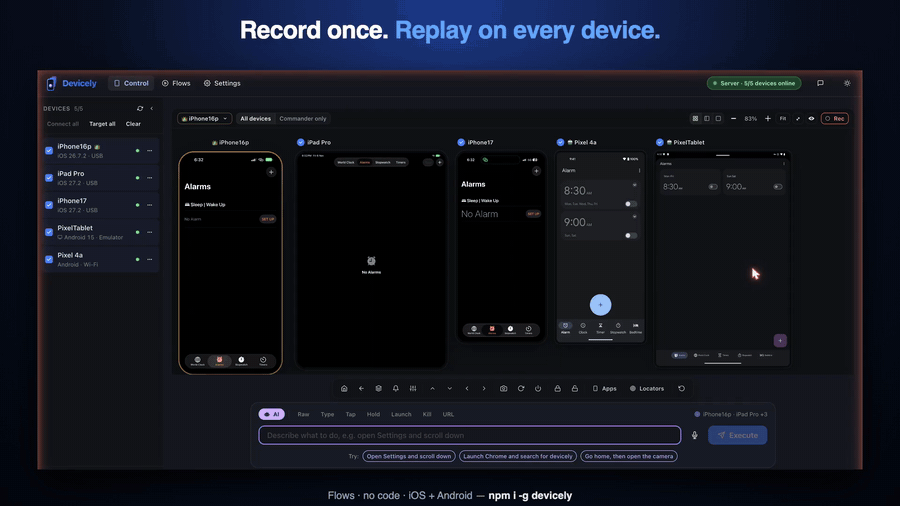

## 10. Real phones, emulators and simulators. One fleet.

Boot an iOS simulator or Android emulator from Devicely and drive it next to physical devices.

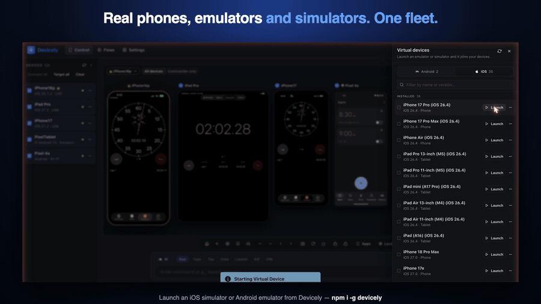

## 11. Claude Code drives real iPhones, iPads and Androids

Over MCP, Claude Code opens Maps on every device, searches for the Eiffel Tower and verifies the result per device. It reports the one device it couldn't verify instead of hiding it.

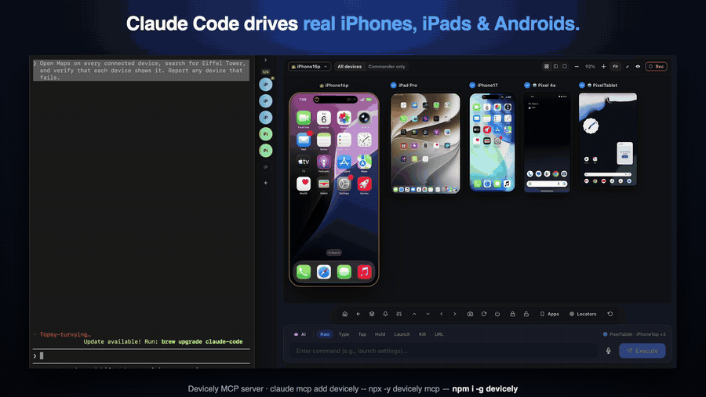

Set it up: `claude mcp add devicely -- npx -y devicely mcp`, or the plugin: `/plugin marketplace add sureshkumarm8/Devicely`. More in [For AI agents](../README.md#for-ai-agents-mcp-server).

---

Found something you'd like to see? [Start a discussion](https://github.com/sureshkumarm8/Devicely/discussions) or [try Devicely with me](https://github.com/sureshkumarm8/Devicely/discussions/2).
